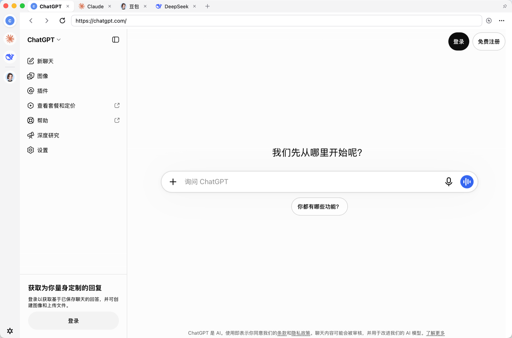

# chatBox

[English](README.md) | 简体中文

[](https://github.com/weigram/chatBox/actions/workflows/build.yml)

把常用的网页版 AI 聊天聚合到一个窗口里：左侧 Dock 栏放着你打开的每一个聊天，
点一下就切换，页面不会重新加载；每个聊天还能各带一份自定义 CSS 与 JS。

用 [mygo](https://github.com/egoist/mygo) 写的：纯 Go、没有 cgo、没有前端构建，
网页跑在系统自带的 WebView（macOS 上是 WKWebView）里，界面是 mygo 自己画的
原生 UI。一个二进制，十几 MB。



左侧 Dock 栏放着打开的每一个聊天——它们同时也是标题栏里的标签——剩下的整块就是网页。

## 下载

编译好的包在 [Releases](https://github.com/weigram/chatBox/releases) 里：

| 平台 | 文件 |
| --- | --- |
| macOS，通用包（Intel 与 Apple 芯片都行） | `chatBox.zip`（里面是 `.app`）、`chatbox-0.1.0.dmg` |
| Windows，64 位 | `chatbox-setup-0.1.0-amd64.exe`（安装版）、`chatBox.exe`（免安装） |
| Linux，64 位与 arm64 | `chatbox-0.1.0-linux-<arch>.tar.gz`（带 `install.sh`）、`chatbox_0.1.0_<arch>.deb` |

这些包都没有签名。macOS 上第一次打开要右键 →「打开」，或者执行
`xattr -dr com.apple.quarantine chatBox.app`；Windows 上在 SmartScreen 里点
「更多信息」→「仍要运行」。Linux 需要 WebKitGTK 4.1 与 GTK 3（Debian / Ubuntu 是
`libwebkit2gtk-4.1-0`，Fedora 是 `webkit2gtk4.1`）。

## 功能

- **内置聊天**：ChatGPT、Claude、Gemini、DeepSeek、豆包、Kimi、通义千问、
  智谱清言、文心一言、腾讯元宝、Grok、Mistral、Perplexity、Copilot。
  它们只是普通聊天，可以改名、改网址、删掉，也可以一键恢复。
- **自己添加**：名称、网址、图标三样都能填，图标可以上传 PNG / JPEG / GIF /
  WebP / BMP / SVG / ICO。
- **按网址自动识别**：编辑器里的「识别」按 HTML 的 `<title>` 和
  `<link rel="icon">`（含 `apple-touch-icon`，没有就取 `/favicon.ico`）
  填名称和图标；聊天第一次打开成功后，若还没有图标，也会从页面里读一次并缓存。
- **左侧 Dock 栏**：**固定的聊天在上**，一条细线，**下面才是当前打开的**。关掉一个
  固定聊天的标签页，它仍留在上面，点一下重新打开。**固定的图标可以上下拖着排序**
  （拖的时候跟手、松手落位，顺序写进 `chats.json`）；下面那组按打开顺序排，不能拖。
  宽度照着 Cherry Studio 收到 **48px**（圆片统一 32、图标 22，两边各留 4）。
  每个图标都坐在同样大小的白圆片上；当前显示的那个是**纯白并带一点投影**，其余是
  半透明的白（选中不放大，大小始终一致）；鼠标停在哪一行，那一行的圆片更白一些。
  整行都是热区，点哪儿都能切换。右键图标可以编辑、固定、重新载入、打开开发者工具、
  清空缓存、关闭。没图标的聊天显示名字首字母，圆形。底部只有一个纯图标的齿轮
  （设置），平时没有底色，指上去才浮出来；新增聊天在标签栏的 ＋ 与 `⌘N` 里。
- **多个聊天同时活着**：切走只是不显示，页面还在后台，切回来接着用；
  关掉标签才释放。每个聊天的 Cookie / 登录状态默认共享且跨启动保留。
- **注入 CSS 与 JS**：每个聊天一份，保存在配置里，页面加载时自动注入；
  保存后立刻作用到已经打开的页面，不用刷新。
- **每个聊天各自的代理**：跟随系统 / 直连 / 自定义 http、https、socks5（可带账号
  和口令，可写不走代理的域名）。走代理的聊天，页面里**所有**请求（含第三方 CDN、
  登录、接口）都从这份代理出去，别的聊天不受影响。
- **配色照 Cherry Studio**：标题栏那条是浅灰（`#F4F4F5`，和左侧 Dock 同色），
  选中的标签是灰底上的一块白（带一点投影）；Dock 里每个图标都坐在同样大小的
  白圆片上，选中的那个更白；工具栏的按钮平时没有底色，只有指针停上去才浮出浅灰。
  深色主题下这几处自动对调。
- **地址栏可编辑**：网址那一格没有底色，只有一圈 1px 的细边框；**点进去就能改**，
  回车前往（自动补 `https://`，不像网址的词会当关键词去搜）。编辑时聚焦框会变成
  强调色，页面跳转也不会覆盖正在输入的内容。
- **地址栏默认收起**：页面上方那一行（后退 / 前进 / 重新载入、网址、代理图标、⋯ 菜单）
  默认不显示，窗口里只剩标签和页面本身，更像「把网页装进窗口」。要用就去「设置 →
  显示地址栏」打开。收起时重载、开发者工具、在浏览器中打开这些仍在右键标签的菜单里。
- **标签可拖动排序**：在标签上按住左右拖，松手落到指针下面那一格（拖动时该标签变淡）；
  顺序就是 Dock 下面那组的顺序，一起写进 `chats.json`。
- **标签就在标题栏里**：窗口用的是「隐藏标题栏」——标签栏铺在窗口最上面那一行，
  缩到左上的三个交通灯直接压在它左侧（那块用 Dock 的底色接下去），所以比一般的
  浏览器式布局还省一行；拖这段空白可以拖窗口。每个聊天一个标签（图标、名字、关闭 ×），
  点标签切换，末尾的 ＋ 再开一个。
- **全局快捷键**：任何应用里按下 `⌘⇧M`（先在「设置」里打开「启用」），窗口就显示 / 隐藏。
- **窗口固定在最前**：**标签栏最右边**那个图钉（窗口右上角；亮起来就是生效），
  立即生效并记住。
- **其它**：前进 / 后退 / 重新载入、自定义 User-Agent、页面缩放、独立会话
  （这个聊天的 Cookie 和缓存跟别的分开）、注入到 iframe、窗口位置记忆。

## 运行

需要 **Go 1.27.3 或更新**（`go.mod` 的要求，旧一些的 Go 连这个模块都编译不了）。

```sh
make run
```

也可以直接 `go run .`。第一次运行会写入内置聊天，Dock 里先放四个（ChatGPT、
Claude、Gemini、DeepSeek），点哪个才加载哪个。

> 网络：官方 `proxy.golang.org` 在国内常常不通，`Makefile` 默认用
> `GOPROXY=https://goproxy.cn,direct`；需要别的镜像就 `export GOPROXY=...`。
>
> 缓存：默认用 Go 自己的缓存目录；只能写当前目录的环境（沙箱、临时机）用
> `make LOCAL=1 run`，缓存会落到 `.cache/`（已在 .gitignore 里）。

## 用法

| 想做的事 | 怎么做 |
| --- | --- |
| 打开一个聊天 | 点标签栏末尾的 `+`，在「聊天列表」里选；或 `⌘N` 新建 |
| 切换聊天 | 点左侧 Dock 的图标，或顶部的标签 |
| 改名字 / 网址 / 图标 | 「聊天列表」每行**最右边的铅笔按钮**，或右键 Dock 图标 →「编辑聊天…」 |
| **固定到 Dock 栏** | 右键标签 / Dock 图标 / 列表行 →「固定到 Dock 栏」。固定的聊天**一直留在 Dock 最上面**，关掉标签页也不消失；再点一次「取消固定」放手 |
| 自动识别名称和图标 | 编辑器里填好网址，点「识别」 |
| 去别的页面 | 在地址栏输入网址后回车（自动补 `https://`；不写网址就当关键词搜索） |
| 注入 CSS / JS | 「编辑聊天…」→「CSS 注入」/「JS 注入」页签 |
| 关闭标签 | 点标签上的 ×，或右键 Dock 图标 →「关闭标签页」 |
| 重新载入 / 开发者工具 | 右键标签或 Dock 图标，菜单里这两项都在；打包后的 .app 里检查器也**能开** |
| 从列表里彻底删除 | 在「聊天列表」里右键那一行 →「从列表中删除」，会二次确认 |
| 清缓存 / 退出登录 | 右键标签或 Dock 图标 →「清空缓存…」，可选只清缓存、或连 Cookie 与本地存储一起清 |
| 找别的聊天 | 标签栏末尾的 ＋，打开「聊天列表」，里面有全部内置和自己加的 |
| 显示 / 隐藏窗口 | 任意应用里按 `⌘⇧M`（默认，可在「设置」里改） |
| 让窗口盖住别的应用 | 标签栏最右的图钉图标 |
| 改快捷键、看数据目录 | Dock 底部唯一那个齿轮图标 |
| 给某个聊天设代理 | 右键 Dock 图标 →「编辑聊天…」→「代理」页签 |
| 在页面里右键 | 保留系统那一套（拷贝、粘贴、查询、翻译、拼写、服务、检查元素），并补上浏览器的那几项，见下 |

快捷键在原生界面有焦点时生效（在网页里按键归网页）：`⌘N` 新建聊天，`⌘L` 打开聊天列表。
全局快捷键不受这个限制。

## 每个聊天各自的代理

编辑器里的「代理」页签有三个选择：

| 选择 | 含义 |
| --- | --- |
| 跟随系统 | 默认。系统代理怎么走就怎么走，本应用不插手 |
| 直连 | 无视系统代理，这个聊天的所有请求直连（内网聊天常用） |
| 自定义 | 填 `http://127.0.0.1:7890`、`https://…` 或 `socks5://` 加账号口令的地址；下面还能列「不走代理」的域名，它们的子域也算 |

几点要知道的：

- **粒度是"每个聊天"而不是"每个域名"**：这个聊天的页面里，不管请求打到哪个域名
  （站点自己、CDN、登录、接口），都走它这一份代理；别的聊天各按各的设置。
- **走代理（或直连）的聊天会自动使用独立会话**：它的 Cookie、登录状态、缓存与
  其它聊天分开。这是系统的前提——代理是按"网站数据存储"分的，不是按窗口分的。
  反过来说：**给一个原来共享会话的聊天打开代理，它就要重新登录一次**；把代理改回
  「跟随系统」又会回到原来那份登录。
- **需要 macOS 14 或更新**：这套走的是 `WKWebsiteDataStore.proxyConfigurations`，
  更早的系统上会提示"代理没生效"，聊天本身照常用。
- **改完会重新载入该聊天的页面**：代理在页面下一次请求时生效，重载最干净。
- 用了代理或选了直连的聊天，工具栏地址栏右边会挂一个**代理图标**（圆圈里的闪电），
  鼠标放上去显示具体是哪个代理，点一下直接打开这个聊天的代理设置。

怎么确认它真的走代理了：仓库里带了一个只会打日志的本地 CONNECT 代理。

```sh
go run ./tools/testproxy 127.0.0.1:18888     # 另开一个终端
# 然后把某个聊天的代理设成 http://127.0.0.1:18888 并打开它，
# 那边会打印 CONNECT example.com:443 这样的行，就是它走的。
```

### 为什么内置了一份 mygo

macOS 的 WKWebView **没有** per-webview 的代理开关，而且实测**不认**
`HTTP_PROXY`/`HTTPS_PROXY` 环境变量——系统 webview 的请求只按"网站数据存储"分流，
而 mygo 原来既没有这个字段，也没暴露 data store 指针。所以项目里内置了一份打过
补丁的 mygo（`third_party/mygo`，go.mod 用 `replace` 指过去）：给 `Session` 加了
`SetProxy`，Darwin 后端用 Network.framework +
`WKWebsiteDataStore.proxyConfigurations` 实现。改动很小，说明和升级步骤见
[third_party/mygo/PATCH.md](third_party/mygo/PATCH.md)。

## 页面里的右键菜单

网页里的右键是 WebKit 的原生菜单，应用在它上面**补**了浏览器才有的那些，而不是
换掉它（换掉会丢翻译、查询、拼写建议、服务这些系统项）：

| 位置 | 项 |
| --- | --- |
| 菜单顶部 | 后退、前进、重新载入（WebKit 自己给了就不重复） |
| 选中文字后 | 复制选中文字、**复制所选中内容的链接**、在浏览器中搜索“…” |
| 右键在链接上 | 复制链接地址、用默认浏览器打开链接 |
| 常驻 | 复制页面地址、用默认浏览器打开当前页、打印…、检查元素 |

- **复制所选中内容的链接**做的是 Safari 那件事：给你一个带文本片段
  （`#:~:text=…`）的网址，对方用浏览器打开会直接跳到并高亮你选的那段文字。
- **在浏览器中搜索**用哪个搜索引擎在「设置 → 搜索用网址」里改，`%s` 是关键词
  位置，默认 `https://cn.bing.com/search?q=%s`。
- 想看当前的菜单到底有哪些项，用调试变量把菜单打进日志：

  ```sh
  CHATBOX_DEBUG_MENU=1 CHATBOX_DEBUG_LOG=/tmp/menu.log make run
  # 然后在网页里右键，/tmp/menu.log 里会出现 debug: page menu of …: [ … ]
  ```

- 这套是跟着 WebKit 的菜单走的，所以在 macOS 上验过；mygo 在 Windows / Linux
  上也有同样的接口，但没在这台机器上验。

## 全局快捷键与窗口置顶

- **关窗口≠退出**：点左上角的红点（或 ⌘W）只是把窗口**收起来**，应用还在后台，
  全局快捷键照旧可用；按快捷键或点 Dock 图标就能召回。真正退出用 ⌘Q。
- **默认键位**：`CmdOrCtrl+Shift+M`（macOS 上是 `⌘⇧M`），但**默认不启用**——
  第一次运行时只是把键位填好，要自己去「设置」里把「启用」打开。
- **录制键位**：设置里点一下快捷键方框就开始**录制**，按下组合键即生效（要带
  ⌘ / ⌥ / ⌃ / ⇧ 之一）；`Esc` 取消，`⌫` 清除。**改了键位，「启用」会自己关掉**，
  要重新打开。
- **启用前查一次**：把「启用」打开时会先试着向系统注册这个组合——被别的应用占着
  时系统会拒绝，于是弹出说明，你可以「先不开」，也可以「仍然启用」：打开，但等
  对方放开那个组合才真正生效。另外 `⌘N` / `⌘L` 这类本窗口自己的快捷键也会被提示。
- **按一下的行为**：窗口正好在你眼前（可见、没最小化、应用是当前应用）时把它
  藏起来；其它情况下把它调出来并聚焦。
- **键位写法**：录制产生的是 mygo 的加速键，如 `Super+Shift+M`（`Super` 就是
  macOS 的 ⌘）；手改 `chats.json` 时也可以写 `CmdOrCtrl+Shift+M`。
- **后台常驻**：关掉窗口后进程不会退出（否则快捷键随进程一起消失），也不会重新
  加载页面——收起来再召回，正在输入的内容、滚动位置都还在。
- **窗口置顶**：标签栏一端的图钉，点一下变成白色小圆片就是生效（22px 的圆，比工具栏
  按钮还小一号）。它放在**系统按钮不占的那一侧**——macOS 在右（交通灯在左），
  Windows 在左（最小化 / 最大化 / 关闭在右）。它跟着系统记住，下次启动窗口就是置顶的。

## 注入的 CSS 和 JS

- CSS 在文档开始时注入（页面的脚本跑之前），所以能在闪一下之前就藏元素；
  JS 在 `DOMContentLoaded` 之后跑，可以直接查 DOM。
- 保存后立刻应用到当前页面，同时写进页面自己的 `localStorage`，
  之后刷新、跳转也还是新的；不需要重建 WebView，也不会打断正在进行的对话。
- 「高级选项」里的「CSS 与 JS 也注入页面里的 iframe」会打开
  `allFrames`，适合那种把内容放在 iframe 里的站点。
- 注入的 JS 抛错只会打到页面的 console（`[chatBox] 注入脚本出错`），
  不会弄崩应用。
- 想在网页的开发者工具里调试，右键 →「开发者工具」。

## 数据放在哪

macOS：`~/Library/Application Support/chatBox/`

```
chats.json        聊天（含各自的代理与绕过域名）、Dock 顺序与固定状态、当前聊天、快捷键与置顶开关
icons/            聊天图标（按需缓存）
```

- 想放到别处（比如 U 盘或项目目录里，方便备份），设环境变量：

  ```sh
  CHATBOX_HOME=/path/to/dir go run .
  ```

- `chats.json` 是普通 JSON，可以直接看、直接改；改完重启应用生效。
- Cookie 和网站存储走系统 WebView 自己的目录：
  `~/Library/WebKit/app.mychatbox.desktop/` 和
  `~/Library/HTTPStorages/app.mychatbox.desktop.binarycookies`；
  配了代理或勾了「独立会话」的聊天各另有一份（`WebsiteDataStore/<uuid>/`）。

## 打包

```sh
make build     # build/darwin-arm64/chatBox.app
make dmg       # 顺带生成磁盘映像
```

产物名字、bundle id、版本在 `mygo.json` 里改；图标是 `resources/icon.png`
（`make icon` 会用 `tools/mkicon` 重新画一张）。

bundle id 仍然是改名前的 `app.mychatbox.desktop`，**是故意的**：系统按它存放 Cookie
和网站数据，换掉就等于所有聊天一起退出登录。想要一个干净的身份可以改，代价就是那一次
重新登录。

画图标时有个讲究：白气泡的尾巴**不能贴到圆角**。尾巴离圆角太近，缩小到 Dock
尺寸（32–64px）时，圆角那圈渐变色会被挤掉，看起来就像"左下角被切了一块"。
`tools/mkicon` 现在会自己量：白色部分必须离方块边缘留出 ≥ 5.5% 的余量，
否则直接报错不写文件。尾巴本身是个三角，挂在气泡下沿、尖朝下（左边竖直、右边斜边）。

> 换过图标后，macOS 可能还在显示旧缓存：`killall Dock` 一下就刷新。

## 代码结构

```
main.go     启动：应用名、数据目录、窗口
app.go      应用状态：打开/切换/关闭聊天、编辑器保存、自动识别、Dock 与工具栏
view.go     Dock 图标、聊天列表、编辑器、设置四个界面
model.go    Chat 与 Store：chats.json 读写、内置聊天、固定的顺序
proxy.go    聊天代理的三种模式、校验与解析
recorder.go 快捷键的录制、显示与冲突检查
pagemenus.go 网页右键菜单：WebKit 的原生项 + 浏览器那些项
widgets.go  小控件与图标：图钉、后退/前进/刷新、＋、齿轮、关闭 ×、代理标记
meta.go     按网址读标题和图标（HTTP + x/net/html）
icons.go    图标解码（含 ICO 里的 PNG）、缩放与缓存
inject.go   注入脚本的模板、即时应用
debug.go    开发用的自动跑一遍并截图（见下）
third_party/mygo  内置的 mygo（打了"每个 session 可单独走代理"的补丁）
tools/      mkicon（画应用图标）、testproxy（只打日志的本地 CONNECT 代理）、
            watchbuild（改完自动构建）
```

## 开发

```sh
make test    # ui.NewTester 跑视图，不需要开窗口
make vet
make watch   # 常驻：改完任何 .go / 资源就自动 make build
```

`make watch` 是 `tools/watchbuild`：它轮询文件时间（不依赖 fswatch），任何 `.go`、
`mygo.json`、`resources/` 里的图片改动，静默 1 秒后自动跑一次 `make build`，
所以 `build/darwin-arm64/chatBox.app` 永远是最新的。改错了编译不过时它只打日志、
继续盯着，不会退出。

```sh
make watch
# 20:03:19 watching …; a change runs make build
# 20:03:38 built in 660ms
#   ✓ Built chatBox 0.1.0 in 555ms
```

想自己按需构建、不想常驻，就 `make build`；想连 dmg 一起出就 `make dmg`。

应用里留了一个只在环境变量存在时才生效的自检：打开 Dock 里第一个聊天，
等页面加载完，打印标题和注入结果，把窗口截图存下来，然后退出。

```sh
CHATBOX_DEBUG_CAPTURE=/tmp/shot.png \
CHATBOX_DEBUG_URL=https://example.com/ \
CHATBOX_DEBUG_INJECT=1 \
go run .
```

配合 `CHATBOX_DEBUG_DIALOG=library|editor|css|js|settings|proxy` 可以截到各个
对话框；`CHATBOX_DEBUG_MENU=1` 把网页右键菜单的项打进日志（配
`CHATBOX_DEBUG_LOG=<文件>` 写进文件）；`CHATBOX_DEBUG_TOGGLE=1` 会顺带验证
全局快捷键注册、窗口显示/隐藏、置顶开关，以及错误键位的提示；
`CHATBOX_DEBUG_RECORD=Super+Shift+K` 会在设置里录一次快捷键；
`CHATBOX_DEBUG_CLOSE=1` 会关掉窗口并报告结果（验证"关窗口不退出"）。

代理可以这样自动验证：`CHATBOX_DEBUG_PROXY=http://127.0.0.1:18888` 让第一个
聊天走这份代理，`CHATBOX_DEBUG_SECOND=1` 再打开第二个（不带代理的）聊天，
`tools/testproxy` 的日志里应当只有第一条聊天的 `CONNECT`。

## 已知限制 / 可以继续做

- 只做了桌面端的一个窗口；mygo 也能跑 Linux / Windows，`mygo build -platform`
  可以交叉打包，但界面尺寸和快捷键只在 macOS 上验过。
- 聊天列表里的顺序还不能拖（Dock 的固定组和标签栏可以）。
- 左侧 Dock 的图标悬停时没有「关闭」小按钮（关闭走标签上的 × 或右键菜单）。
- 左侧 Dock 和顶部标签栏大体是同一份列表（都是「已打开的聊天」），只是 Dock 上面
  多了一组固定的。Cherry Studio 的左侧其实是**全部助手**；要改成「左侧 = 全部聊天，
  顶部 = 已打开的标签」也很容易，说一声。
- 自动识别依赖网站返回的 HTML；极端情况下（比如整页都是 JS 渲染、还挡了
  非浏览器 UA）识别会失败，名字和图标可以手填 / 上传。

## 许可

内置的 mygo 是 MIT，见 [third_party/mygo/LICENSE](third_party/mygo/LICENSE)。
本应用自己还没有 LICENSE 文件，决定用哪个就放一份到根目录。
